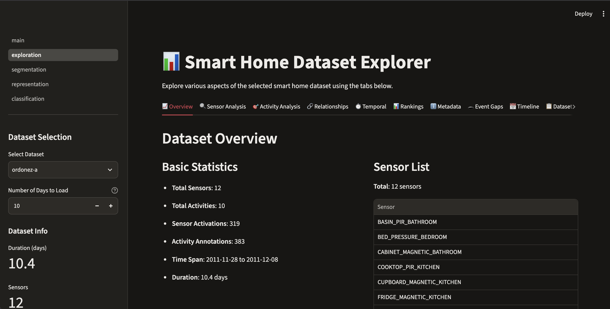
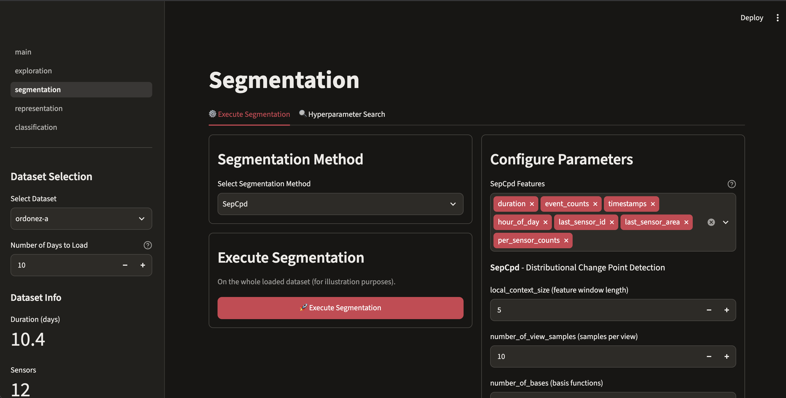
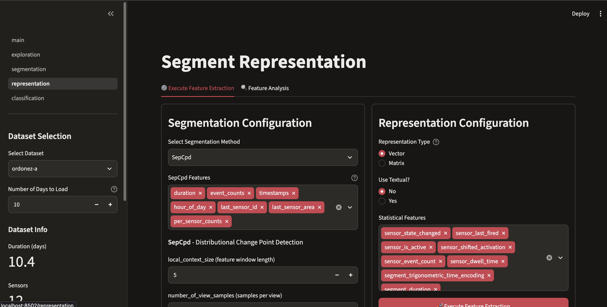
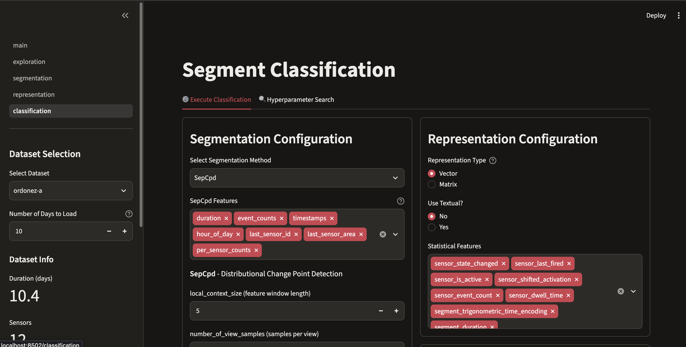

# FlowAR


## Description
A modular, data-driven operational experimental framework designed to support reproducibility and scientific rigor in the development and evaluation of activity recognition systems. Realized as part of PhD research.

FlowAR ships with:

- a Python **backend** package (`backend/`) implementing the full HAR pipeline — dataset loading, event segmentation, feature representation, annotation, classification, hyperparameter optimization, and quality evaluation;
- a **Streamlit frontend** (`frontend/`) to explore smart-home datasets and run each pipeline stage interactively;
- a **demo script** (`scripts/demo.py`) running cross-validation end to end on a bundled dataset.

## Screenshots

<table>
  <tr>
    <td width="50%">
      
      <b>Dataset explorer</b><br>
      Explore smart-home datasets, sensor activity, timelines, and relationships.
    </td>
    <td width="50%">
      
      <b>Segmentation</b><br>
      Configure segmentation methods and hyperparameter searches.
    </td>
  </tr>
  <tr>
    <td width="50%">
      
      <b>Feature representation</b><br>
      Extract and analyze vector or matrix representations of activity segments.
    </td>
    <td width="50%">
      
      <b>Classification</b><br>
      Run classification pipelines and tune model hyperparameters.
    </td>
  </tr>
</table>

## Requirements

- [uv](https://docs.astral.sh/uv/) (Python package and project manager)
- Python 3.12 (uv can fetch it automatically)
- Docker + Docker Compose (only for the containerized workflow)

## Quick start (local, with uv)

```bash
# Install dependencies (creates .venv and installs the project itself)
make install

# Run the Streamlit app
make run
```

Then open http://localhost:8501.

> The app must run from the repository root: the frontend loads datasets from the
> relative path `backend/dataset/content/`.

## Quick start (Docker)

```bash
# Build the image and start the app (http://localhost:8501)
make docker-up

# In another terminal, check the app is healthy
curl http://localhost:8501/_stcore/health

# Run the end-to-end demo pipeline in a one-off container
make docker-demo

# Stop and remove the app containers
make docker-down
```

The `Dockerfile` builds a slim `python:3.12` image, installs [uv](https://docs.astral.sh/uv/)
inside it, and resolves dependencies from `uv.lock` (CPU-only torch wheels on Linux).
The app runs headless on port `8501` with a Docker `HEALTHCHECK` hitting
Streamlit's `/_stcore/health` endpoint.

## Development

Run `make help` to list every available command. The development commands run
from the repository root via `uv run`. The project uses three complementary tools:

- **ruff** — linter + formatter (style, unused imports, simple bugs). Knows nothing about types.
- **mypy** — command-line type checker (`uv run mypy`).
- **pyright** — the engine behind VS Code's **Pylance**. It uses full library stubs
  (pandas, sklearn, scipy, gensim...), so it catches things mypy misses, e.g. `Literal`
  mismatches or read-only `MappingProxyType`. Run it with `uv run pyright`;
  configuration lives in `pyrightconfig.json` (Pylance reads the same file).

```bash
# Lint (auto-fix) and format
make lint
make format

# Type checking (CLI + editor/Pylance)
make typecheck

# Tests — backend coverage is enforced at 100% (branch coverage)
make test

# Run lint, format, type checks, and tests
make check
```

`uv run pytest` fails unless the `backend/` package reaches **100% coverage**
(`--cov=backend --cov-fail-under=100`, branch coverage enabled, configured in
`pyproject.toml`). Use `--cov-report=html` for an HTML report (`htmlcov/`).

## Project structure

```
flowar-framework/
├── backend/                  # Python package: the FlowAR framework
│   ├── dataset/              #   smart-home dataset loading (CSV + meta.toml)
│   ├── segmentation/         #   event-stream segmentation methods + quality
│   ├── representation/       #   feature extraction (vector/matrix/textual) + quality
│   ├── annotation/           #   segment -> activity labeling
│   ├── classification/       #   shallow + deep classifiers, CV, optimization
│   ├── models.py             #   core data models (Event, Segment, Interval, ...)
│   └── utils.py
|
├── frontend/                 # Streamlit app
│   ├── main.py               #   landing page
│   ├── pages/                #   0_exploration .. 3_classification
│   └── components/           #   shared widgets (dataset loader, runners)
|
├── scripts/demo.py           # end-to-end cross-validation demo
├── tests/                    # pytest suite (100% backend coverage)
├── Dockerfile                # container image for the Streamlit app
├── docker-compose.yml        # `app` service + optional `demo` profile
├── Makefile                  # shortcuts for local and Docker workflows
├── pyproject.toml            # project metadata, deps, ruff/mypy/pytest config
├── pyrightconfig.json        # pyright/Pylance config (also read by VS Code)
└── uv.lock                   # locked dependency set
```

## Cite Papers

Please cite the following papers if you use or refer to FlowAR (code, data) in your research:

### FlowAR: A Framework for Data-Driven Development of Human Activity Recognition Systems using Binary Sensors
Ali Ncibi, Luc Bouganim, Philippe Pucheral  
21st International Conference on Distributed Computing in Smart Systems and the Internet of Things (DCOSS-IoT), 2025.
- https://hal.science/hal-05213603v1

### FlowAR: une plateforme uniformisee pour la reconnaissance des activites humaines a partir de capteurs binaires
Ali Ncibi, Luc Bouganim, Philippe Pucheral  
25eme conference francophone Extraction et Gestion des Connaissances (EGC), 2025.  
Paper links:  
- https://hal.science/hal-04944889v1
